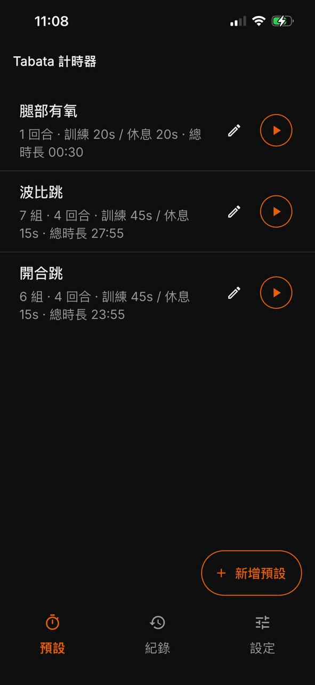
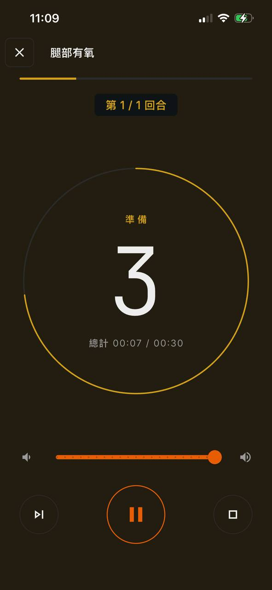
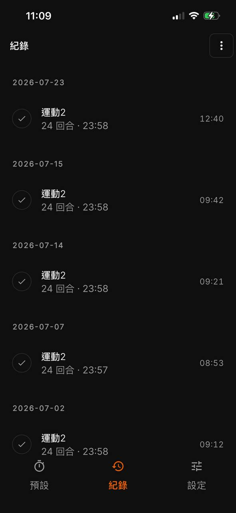

# ⏱️ Tabata Timer

一款專注於高強度間歇訓練（HIIT / Tabata）的高質感跨平台計時器 App，支援 **iOS** 與 **Android**。  
特點為**極簡直覺、離線可用、鎖屏不中斷、語音/震動引導、圖片動作輪播、歷史紀錄與安全備份**。

專案遵循 **Clean Architecture（整潔架構）**，高內聚低耦合，對 Web 前端開發者極為友善。

---

## 📱 使用畫面 (Screenshots)

<div align="center">
  <table>
    <tr>
      <td align="center" width="33%">
        <b>📋 課表清單 (Presets)</b><br/><br/>
        <br/><br/>
        <sub>內建經典課表、自訂時間、相簿關聯</sub>
      </td>
      <td align="center" width="33%">
        <b>🔥 訓練中計時 (Active Timer)</b><br/><br/>
        <br/><br/>
        <sub>大數字倒數、階段顏色進度環、3-2-1 語音</sub>
      </td>
      <td align="center" width="33%">
        <b>📊 訓練歷史 (History)</b><br/><br/>
        <br/><br/>
        <sub>日期分組、左滑刪除、JSON 匯出入與密碼保護</sub>
      </td>
    </tr>
  </table>
</div>

---

## ✨ 核心特色

- ⏱️ **極限防漂移計時引擎**：採用 Wall-Clock（真實時鐘比對）而非依賴不穩定的計數器，切換分頁或背景運行分秒不差。
- 🔇 **iOS 背景保活黑科技**：在 iOS 鎖屏/縮小下透過微音量循環音訊維持系統 CPU 活躍，訓練不中斷。
- 🗣️ **全方位多感官引導**：
  - **TTS 語音**：支援倒數 3-2-1、過半提醒（Halfway）、階段名稱朗讀（中/英自動切換）。
  - **雙保險震動**：階段開始與切換專屬觸覺震動。
  - **音效提示**：系統級提示音，不佔用額外資源。
- 🖼️ **課表相簿與輪播背景**：支援為課表添加運動動作引導照片，訓練時隨階段或時間自動輪播。
- 🛡️ **安全與備份**：訓練完成自動儲存；支援 JSON 備份匯出入；清除紀錄支援密碼防呆保護。
- 🌐 **多語系與主題**：原生支援繁體中文 (zh-TW) 與英文 (en)；支援 Material 3 深色/淺色/跟隨系統。

---

## 🏗️ 架構設計 (Clean Architecture)

專案嚴格落實**由外向內依賴**原則，業務規則（Domain）完全獨立於 UI 與第三方庫：

```
lib/
├── presentation/  👉 [UI 視圖層] Flutter Widgets、路由 (GoRouter)、主題與語系
│        │ (透過 Riverpod 訂閱狀態與觸發 Intent)
│        ▼
├── application/   👉 [應用協調層] Controllers (WorkoutController, PresetsController)
│        │ (呼叫抽象介面與狀態機)
│        ▼
├── domain/        👉 [領域核心層] 純 Dart！計時引擎 (TimerEngine)、Entities、Repository 介面
│        ▲ (透過依賴注入 Inversion of Control 實作介面)
│        │
└── data/          👉 [基礎設施層] SharedPreferences、音訊保活、TTS、震動、通知實作
```


---

## 🛠️ 技術棧

| 領域 | 使用套件 / 框架 | 說明 |
|---|---|---|
| **Framework** | Flutter 3.x + Dart 3.x | 跨平台雙端原生渲染 |
| **狀態管理** | `flutter_riverpod` | 型別安全、無 BuildContext 依賴的響應式狀態管理 |
| **路由導航** | `go_router` | 宣告式路由，支援 `ShellRoute` 底部導航狀態維持 |
| **不可變模型** | `freezed` + `json_serializable` | 編譯期自動生成 `copyWith`、相等性比對與 JSON 序列化 |
| **本機儲存** | `shared_preferences` | 輕量快速的本機 Key-Value 持久化儲存 |
| **音訊與語音** | `just_audio` + `flutter_tts` | 背景保活循環音訊播放、多語系語音合成朗讀 |
| **裝置互動** | `wakelock_plus` + `vibration` | 運動中防止螢幕休眠、自訂觸覺震動反饋 |
| **本地通知** | `flutter_local_notifications` | 鎖屏常駐顯示目前運動進度與秒數 |

---

## 🚀 快速開始

### 1. 安裝環境與依賴
```bash
# 取得 Flutter 依賴包 (等同 npm install)
flutter pub get
```

### 2. 程式碼生成 (Freezed & JSON)
修改了 Entity 或 DTO 後，執行代碼生成工具：
```bash
# 執行 build_runner (等同 tsc / prisma generate)
dart run build_runner build --delete-conflicting-outputs
```

### 3. 啟動除錯 (Debug)
```bash
# 啟動模擬器或實機執行 (等同 npm run dev)
flutter run
```

### 4. 執行測試
```bash
# 執行單元測試 (等同 npm test / vitest)
flutter test
```

---

## 📂 檔案目錄地圖

```text
lib/
├── di/                     # 依賴注入 (Riverpod Providers 定義)
├── domain/                 # 核心業務邏輯 (純 Dart，無 Flutter 依賴)
│   ├── entities/           # 領域物件 (Preset, History, Settings, Snapshot)
│   ├── repositories/       # 儲存庫抽象介面
│   ├── services/           # 外部服務抽象介面 (音效, 震動, 保活, TTS)
│   └── timer/              # 計時器狀態機核心 (TimerEngine)
├── application/            # 應用狀態控制器 (Workout, Presets, History, Settings)
├── data/                   # 基礎設施與實作 (SharedPreferences, 硬體串接)
│   ├── dtos/               # 資料傳輸物件 (帶 JSON 序列化)
│   ├── repositories/       # 儲存庫具體實作
│   └── services/           # 系統服務具體實作 (SilentLoop, TTS, Wakelock)
├── presentation/           # 使用者介面 (Flutter Widgets)
│   ├── presets/            # 課表清單與編輯器、相簿管理器
│   ├── timer/              # 訓練倒數主畫面、圓形進度環、背景輪播
│   ├── history/            # 歷史紀錄列表、JSON 匯出入對話框
│   ├── settings/           # 主題切換、語系選擇、iOS 憑證狀態
│   ├── routing/            # 頁面路由表 (GoRouter)
│   └── theme/              # Material 3 主題設定與階段色彩
└── l10n/                   # 多國語系文案檔 (ARB 格式)
```
